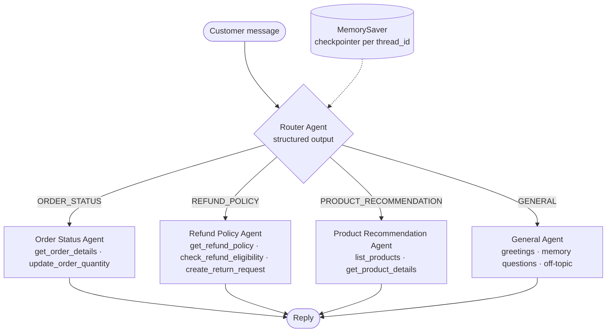
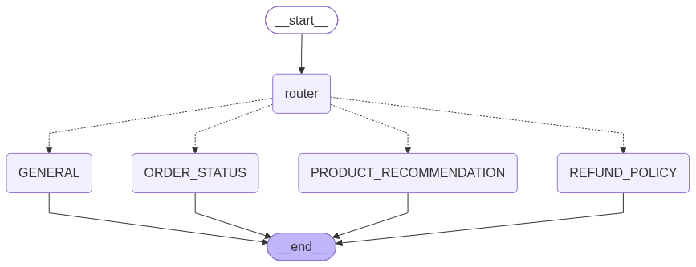

# TechNova Customer Service Chatbot (Agentic AI with LangGraph)

**Author:** Sudish Mulakala (individual project) · 118s – Section 02

A simple **agentic AI chatbot** that acts as a customer service and sales assistant ("**Nova**")
for a fictional laptop store. A **Router Agent** reads each message and hands it to one of
several **specialist agents**. Each specialist has its own system prompt and tools. **LangGraph
`MemorySaver`** stores the conversation so the bot remembers context across turns.

Built from the starter repo
[build-ai-agents-and-chatbots-with-langgraph-2021112](https://github.com/myrah/build-ai-agents-and-chatbots-with-langgraph-2021112).
I replaced the hard-coded **Azure OpenAI** key with the **Google Gemini API or OpenAI API**,
loaded securely.

## Architecture



| Rubric item | How this project meets it |
|---|---|
| Working chatbot + API | `config.py` builds a `ChatGoogleGenerativeAI` (Gemini) or `ChatOpenAI` model. Pick one with `LLM_PROVIDER`, or it is auto-detected from the key you set |
| Clear role (system prompt) | `BASE_SYSTEM_PROMPT` defines Nova's role and rules. Every agent's prompt starts with it, then adds its specialty |
| 3 inquiry types, each with its own agent | **Order Status**, **Refund Policy**, **Product Recommendation**, plus a General agent for small talk |
| Memory (3+ turns, MemorySaver) | The parent graph is compiled with `checkpointer=MemorySaver()`. Each conversation has a `thread_id`, and every agent receives the full saved history |
| Agent logic / routing | The router returns a typed `RouteDecision`, and a LangGraph conditional edge sends the turn to that agent. Inside each agent, an LLM and ToolNode loop decides when to call tools |

### How memory works
1. Each user message is sent with `config={"configurable": {"thread_id": ...}}`.
2. After every turn, `MemorySaver` checkpoints the graph state (`messages` + `route`) for that thread.
3. On the next turn, LangGraph loads the saved messages and appends the new one (`add_messages` reducer).
   The router and the chosen agent see the whole conversation, so "it", "that order" and
   "my name" resolve correctly, even when a *different* agent answered earlier.
4. A new `thread_id` starts with an empty memory, so conversations stay separate.

## Project files
| File | Purpose |
|---|---|
| `Customer_Service_Chatbot.ipynb` | **Main demo with saved outputs**: all 3 inquiry types, multi-turn memory, thread isolation |
| `chatbot.py` | System prompts, Router Agent, `SpecialistAgent` class, parent graph + MemorySaver. Run it for an interactive chat |
| `tools.py` | Tools for each agent (orders, refunds, products) built on the CSV data |
| `config.py` | Secure API key loading (env var / `.env` / Codespaces / Colab secrets) + model setup |
| `data/` | Starter-repo orders & pricing CSVs (3 extra past orders added for refund cases), product descriptions, `refund_policy.md` |
| `tests/test_offline.py` | 7 tests that need no API key (a fake LLM checks tools, routing and memory) |
| `outputs/` | Console transcript and screenshots of successful runs |

## Run it

**1. Get a key.** Gemini is free at <https://aistudio.google.com/apikey>. OpenAI keys come from <https://platform.openai.com/api-keys>.

**2. Store the key securely.** Never paste it into the code. Use one of these:
- **GitHub Codespaces:** github.com/settings/codespaces, then *New secret*, then `GOOGLE_API_KEY` (or `OPENAI_API_KEY`), with access to this repo.
- **Google Colab:** key icon in the left sidebar, then *Add new secret*, then `GOOGLE_API_KEY`.
- **VS Code / local:** `cp .env.example .env` and fill in the key. `.env` is in `.gitignore`, and `.vscode/launch.json` loads it automatically.

**3. Install and run:**
```bash
pip install -r requirements.txt
jupyter notebook Customer_Service_Chatbot.ipynb   # or "Run All" in VS Code / Codespaces
python chatbot.py                                 # interactive chat in the terminal
pytest -q                                         # offline validation tests (no key needed)
python quick_check.py                             # one-line check that your key + model work
```
On macOS you can also double-click **`run_all.command`**. It creates a virtual env, installs
everything, checks the key, runs the tests and executes the notebook, logging to `outputs/run_log.txt`.

Default models: `gemini-3.1-flash-lite` (Gemini) or `gpt-5-mini` (OpenAI). You can change them with
`GEMINI_MODEL` / `OPENAI_MODEL`. My recorded run used **Gemini `gemini-3.1-flash-lite`**.

The sample data is from October 2024, so the store uses a fixed "today" of **2024-10-20**
(`STORE_DATE` in `tools.py`). That keeps order status and refund windows the same on every run.

## Sample output (real run, Gemini)
The full output is saved in `Customer_Service_Chatbot.ipynb`, `outputs/sample_run.txt` and
`outputs/Customer_Service_Chatbot_outputs.html`. Here is an excerpt of the cross-agent memory demo:

```
[Turn 1] USER: Hello, my name is Priya.
   -> routed to: General Agent
[Turn 2] USER: Can you look up order ORD-7311 for me?
   -> routed to: Order Status Agent
NOVA: Certainly, Priya. Your order ORD-7311 for 2 NanoEdge Flex laptops was delivered yesterday, October 19th. ...
[Turn 3] USER: Can I return it if I don't like it?
   -> routed to: Refund Policy Agent
NOVA: Yes, Priya, you are eligible to return your NanoEdge Flex laptops. Our policy allows for returns within 30 days of delivery. ...
[Turn 5] USER: Thanks! Before I go, what's my name and which order did we talk about?
   -> routed to: General Agent
NOVA: You are Priya, and we have been discussing your order ORD-7311. ...
```


